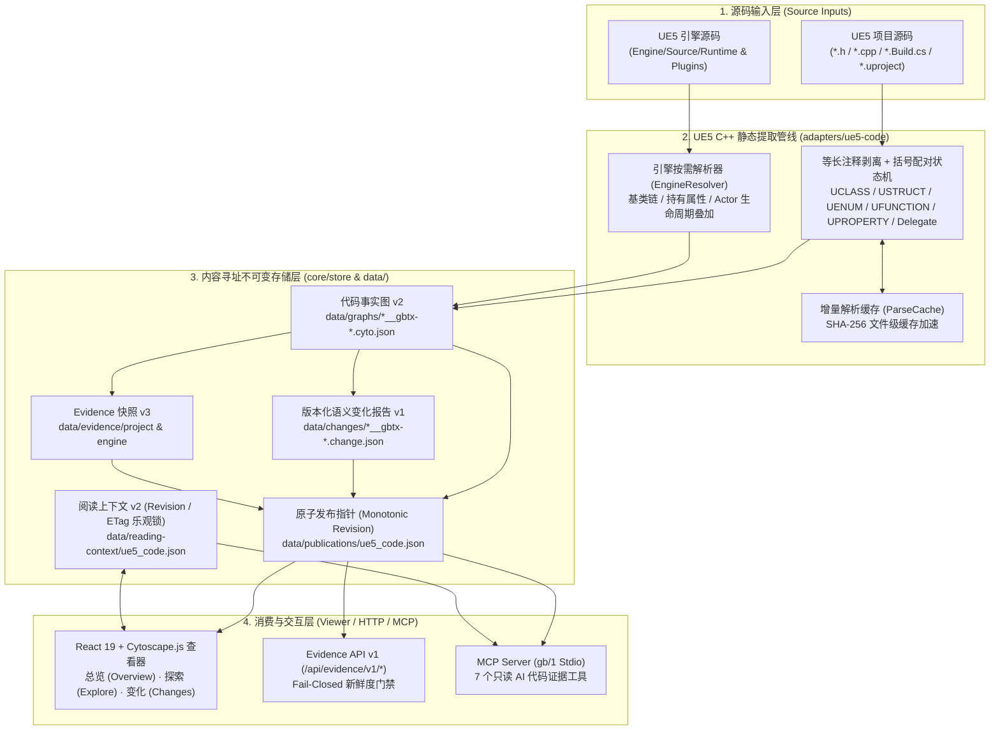

# UE-Intelligence-System (GraphBrain)

<p align="center">
  <strong>本地优先的 Unreal Engine C++ 代码架构洞察、语义差分与 AI 证据系统</strong><br/>
  <sub>Local-First Read-Only UE5 C++ Architecture Viewer, Semantic Diff Engine &amp; Fail-Closed MCP Evidence Server</sub>
</p>

<p align="center">
  
  
  
  
  
</p>

---

## 项目简介

**UE-Intelligence-System（内部代号 GraphBrain）** 是一个面向 **Unreal Engine 5 C++ 项目**的本地优先（Local-First）、只读代码架构分析与 AI 证据供给系统。

它直接从 UE C++ 项目源码（`.h` / `.cpp` / `.Build.cs`）与本机 Unreal Engine 引擎源码中静态提取版本化的 `ue5_code` 代码事实，通过 **SHA-256 内容寻址不可变快照** 与 **单调递增 Revision 发布指针**，同时向人类开发者与 AI Coding Agent 提供同一份具备源码指纹校验（Provenance & Freshness）的真实代码证据：

- **面向开发者（Web 工作台）**：提供 `总览 (Overview)`、`探索 (Explore：架构分带视图 / 关系图与文件森林 / 项目+引擎统一 API 浏览器 & 类 Spec)`、`变化 (Changes：版本化语义差分与一跳关系影响)` 三大一级视图，以及基于源码哈希绑定的代码标注与陈旧度（Staleness）自动扫描。
- **面向 AI Agent（Evidence API v1 & MCP Server `gb/1`）**：通过标准 Model Context Protocol (MCP) 与 HTTP Evidence API 暴露只读符号检索、符号详情、一跳邻域、正/反向影响闭包分析与语义变更查询；默认执行 **Fail-Closed 新鲜度门禁（`require_fresh`）**，当快照落后于源码修改时拒绝静默返回过期事实，从根源消除大模型在大型 UE C++ 工程中的上下文幻觉。

---

## 系统架构与数据流



---

## 核心技术特性

### 1. 零编译依赖的 UE5 C++ 静态提取器（`adapters/ue5-code/`）
- **等长注释剥离与文档块归属**：通过单遍状态机将注释替换为等长空白符（跟踪字符串字面量与转义），使剥离后的字符偏移与原始源码 100% 对齐，无需二次词法分析即可将 `/** ... */` 文档注释精确挂载至紧随其后的类型、函数与属性声明。
- **高鲁棒性 UE 反射与头文件解析**：设置 4MB 单文件边界与顶层分号/括号配对扫描，兼容 `AActor`、`UWorld` 等类体超 64KB 的大型引擎核心头文件；支持提取 `UCLASS`、`USTRUCT`、`UENUM`、`UPROPERTY`、`UFUNCTION`、多播/动态委托声明，以及同名 `.cpp` 中的成员读写、构造函数组件装配与委托绑定。
- **引擎侧按需解析与生命周期融合**：从 `.uproject` 自动定位本机 UE 引擎根目录，构建 30,000+ 引擎头文件索引，沿项目类的**继承基类链**与**成员持有目标**按需解析引擎头文件（止于 `UObject`），并叠加 Actor 生命周期执行链。
- **模块依赖图谱**：自动解析 `*.Build.cs` 中的 `Public/Private/Additional/DynamicallyLoadedDependencyModuleNames`，生成模块级依赖拓扑。

### 2. SHA-256 内容寻址与原子发布协议（`core/store/`）
- **不可变产物（Immutable Artifacts）**：每次提取生成的图谱（`*.cyto.json`）、变化报告（`*.change.json`）与证据快照（`*.gbev3-*.json`）均以内容 SHA-256 哈希寻址落盘，同日多次提取绝不覆盖历史基线。
- **单点原子切换与无损回滚**：完成 JSON Schema（Ajv）、引用完整性与交叉关系校验后，仅通过 `data/publications/ue5_code.json` 的一次单调 `revision` 切换对外发布新代次（Generation），支持一条命令无损回滚（`npm run data:rollback`）与孤儿历史产物安全清理（`npm run data:prune`）。
- **单一事实源（Single Canonical Owner）**：项目事实、引擎按需解析事实、派生变化报告与用户阅读上下文（`reading-context`）严格分离所有权；UI 坐标、筛选状态与缓存永不写回污染代码事实。

### 3. 面向 AI Agent 的 Fail-Closed 证据边界与 MCP Server（`tools/mcp-server.ts`）
- **内置 MCP Server（`gb/1`）**：基于 `@modelcontextprotocol/sdk` 实现标准 Stdio JSON-RPC 服务，向 Claude Code / Cursor 等 MCP 宿主暴露 **7 个纯只读代码证据工具**（架构层面穷举保证零写旁路）：
  - `gb_status`：查询当前发布证据的新鲜度（`current` / `stale` / `unverified`）、消费门禁状态与快照指纹。
  - `gb_search_symbols`：按关键字、类型、模块、所属层（`project` / `engine`）检索代码符号。
  - `gb_symbol_detail`：获取单个类/结构/函数的完整定义、成员、关系计数与源码证据指纹。
  - `gb_neighborhood`：查询指定符号的一跳依赖与被依赖邻域。
  - `gb_impact`：执行基于种子节点的**反向修改波及分析（Impact）**或**正向阅读闭包计算（Closure）**。
  - `gb_changes`：按 `added` / `changed` / `removed` 及模块切片查询活动变化报告。
  - `gb_annotations_get`：读取绑定的代码设计决策、性能注意点（Gotcha）等人工标注。
- **Fail-Closed 新鲜度门禁**：每次查询默认比对工作树源码 SHA-256 指纹；若源码已变更而图谱未刷新，自动返回 `EVIDENCE_STALE`（HTTP `412 Precondition Failed`）诊断并拒绝吐出过期事实，除非调用方显式声明 `allowStale=true`。

### 4. 多维交互式架构探索工作台（`viewer/`）
- **`0` 总览 (Overview)**：集中展示活动代码图规模、提取覆盖率（Coverage Diagnostics）、来源指纹与新鲜度状态。
- **`1` 探索 → 架构 (Architecture)**：按职责分带（Archify 风格）可视化模块与核心类的分层职责结构。
- **`2` 探索 → 关系 (Relations)**：基于 Cytoscape.js + fCoSE 确定性布局与重叠消解，支持**项目关系图**与**引擎模块文件森林**双视角探索。
- **`3` 变化 (Changes)**：对比两个提取快照，严格区分**直接语义变化节点**与**一跳关系波及节点（One-Hop Affected）**，点击可直接定位回活动图。
- **`4` 探索 → API & 类 Spec**：统一检索项目与 UE 引擎 API，查看只读类 Spec 卡片（继承链回溯、函数分区过滤、源码行级锚点）并管理受 ETag/Revision 乐观锁保护的代码标注与收藏。

### 5. 工程标准与自动化质量门禁（`scripts/` & `tests/`）
仓库受 [工程编码标准 v1](docs/engineering-standard-v1.md) 与 [全工具工程宪法](AGENTS.md) 约束（约 **34,000 行** TypeScript/TSX 核心代码 + **9,100+ 行**测试代码，共 **101 个测试文件**）：
- **`engineering-standard-gate`**：静态扫描全仓代码，拦截任何未在 `config/engineering-standard-exceptions.json` 登记的显式 `any`、类型压制指令或过期豁免（当前保持 **0 例外基线**）。
- **`layer-gate` & `gate:arch`**：强制校验 `core → adapters` 运行时分层边界，并基于 `data/architecture-baseline.json` 拦截新增模块依赖回路。
- **浏览器冒烟与内存浸泡门禁（`smoke:soak`）**：在同一浏览器 Document 中循环切换五大工作区，强制 GC 后断言 JS Heap、DOM 节点数与事件监听器的保留斜率，防止长生命周期常驻服务内存泄漏。
- **内容寻址常驻服务部署（`service:prepare / activate / rollback`）**：将前端构建产物、Server Runtime 与 Bootstrap 打包为 SHA-256 校验的 Release v3 不可变候选包，通过临时端口完成全视图自动化验收后才允许切换生产状态。

---

## 目录结构

```text
UE-Intelligence-System/
├── adapters/
│   ├── ue5-code/          # UE5 C++ 头文件/源文件解析器、引擎按需解析、生命周期与增量缓存
│   ├── adapter-interface.ts
│   └── registry.ts        # 唯一活动 Adapter 注册表 (ue5_code)
├── core/
│   ├── annotation/        # 代码标注存储投影与源码变更陈旧度 (Staleness) 扫描
│   ├── evidence/          # Evidence API v1 查询、新鲜度评估、版本迁移与解析边界
│   ├── hooks/             # 版本控制提交钩子与常驻轮询更新器
│   ├── query/             # 图分析纯算法（回路检测、耦合度、正反向影响闭包、语义差分报告）
│   ├── reading-context/   # 标注与收藏的唯一持久化所有者（Revision / ETag 冲突保护）
│   ├── schema/            # Ajv JSON Schema 校验、图目录归一化与版本迁移
│   ├── service/           # 常驻服务 Release v3 部署契约与运行时稳定性检测
│   └── store/             # SHA-256 内容寻址发布指针、原子写与文件锁
├── server/                # 本地 HTTP API 路由族（Catalog / Graph / Changes / Evidence / Engine / 410 兼容边界）
├── viewer/                # React 19 + Cytoscape.js 前端工作台（Overview / Explore / Changes）
├── tools/                 # CLI 工具集（MCP Server、Evidence CLI、数据发布/回滚/清理、Archify 桥接器等）
├── scripts/               # 工程门禁（engineering-standard-gate、layer-gate、gate-arch、服务启动器）
├── tests/                 # 101 个单元、契约、迁移、MCP 协议与浏览器 Smoke/Soak 测试
├── data/                  # 内置示例快照数据（图谱 v2、变化报告 v1、Evidence v3、发布清单与历史归档）
└── docs/                  # 架构说明、数据 Schema、工程编码标准 v1、使用手册与演进审计文档
```

---

## 快速开始

### 环境要求
- **Node.js** >= 20（推荐使用最新 LTS 版本）
- **npm** >= 10

### 1. 安装依赖并启动查看器（开箱即用）
仓库 `data/` 目录已内置一份完整的 UE5 C++ 项目提取快照与语义变化报告，无需本机安装 Unreal Engine 即可直接启动体验全部视图：

```powershell
npm install
npm run viewer
```

启动后在浏览器访问 `http://localhost:3030`。

- 快捷键：`0` 总览 | `1` 探索·架构 | `2` 探索·关系 | `3` 变化 | `4` 探索·API | `/` 全局搜索 | `?` 快捷键帮助 | `F` 适配画布

### 2. 提取你自己的 UE5 C++ 项目

#### （1）配置引擎路径（可选，用于引擎基类按需解析）
提取器默认从项目的 `.uproject` 推导引擎版本，并在常见安装路径查找引擎源码；也可通过环境变量显式指定本机 UE 引擎根目录：

```powershell
$env:GRAPH_BRAIN_ENGINE_ROOT = "C:/Program Files/Epic Games/UE_5.5"
```

#### （2）运行 C++ 源码提取与语义变化分析

```powershell
# 从 UE 项目的 Source 目录提取代码事实图并原子发布（支持 --incremental 增量缓存）
npm run extract:ue5-classes -- <你的UE项目>/Source --subsystem project --out data/graphs --incremental

# 对比两个图快照生成版本化语义变化报告
npm run build:change-report -- --baseline <基线图.cyto.json> --current <当前图.cyto.json> --data-dir data

# 查看发布状态、无损回滚或清理未引用的历史快照
npm run data:status
npm run data:rollback -- --subsystem project
npm run data:prune             # dry-run 预览可清理文件
npm run data:prune -- --apply  # 执行安全清理

# 运行依赖回路、模块耦合与修改影响范围分析（默认仅终端输出）
npm run analyze -- --graph ue5_code_project_ --cycles --coupling
npm run analyze -- --graph ue5_code_project_ --impact-files MyCharacter.h

# 扫描代码变更后的陈旧标注
npm run annotations:scan -- ue5_code project
```

#### （3）配置自动刷新项目源（`core/hooks/hook-projects.json`）
如需使用 `npm run evidence:refresh` 或提交自动更新，可在 `core/hooks/hook-projects.json` 中将 `projects[0]` 的 `root`、`extract.roots` 与 `extract.uproject` 指向你的本地 UE 工程路径。

### 3. 接入 AI Coding Agent（MCP Server & Evidence CLI）

在支持 MCP 的客户端（如 Claude Code / Cursor）中添加 Stdio 服务配置：

```json
{
  "mcpServers": {
    "graphbrain": {
      "command": "npx",
      "args": ["tsx", "tools/mcp-server.ts"],
      "cwd": "/path/to/UE-Intelligence-System"
    }
  }
}
```

也可直接通过命令行使用 Evidence 工具链：

```powershell
npm run evidence:status              # 查看当前代码证据新鲜度与覆盖率
npm run evidence:check               # Fail-closed 新鲜度门禁检查
npm run evidence:refresh             # 触发增量提取、生成 Evidence v3 快照并扫描陈旧标注
npm run archify:bridge -- --class AMyCharacter --depth 1
```

---

## 质量验证与工程门禁

```powershell
npm run check:fast       # 工程标准门禁 + 分层依赖门禁 + TypeScript 严格类型检查 + 单元/契约测试 + Schema 校验
npm run check:data       # Evidence 契约、查询、快照迁移、归档完整性与新鲜度门禁验证
npm run check:release    # 全量门禁 + 生产构建 + 首屏 Bundle 边界检查 + 浏览器多视图冒烟测试
npm run check:lifecycle  # 多工作区反复切换 + 强制 GC 内存/DOM/监听器泄漏浸泡测试 (Soak Test)
```

---

## 延伸阅读

- [使用说明 (USAGE)](docs/USAGE.md)
- [架构与边界 (Architecture)](docs/architecture.md)
- [产品定位与可信度边界 (Product Positioning)](docs/product-positioning.md)
- [工程编码标准 v1 (Engineering Standard)](docs/engineering-standard-v1.md)
- [数据格式与 Schema (Data Schema)](docs/schema.md)
- [工具链契约 (Toolchain Contract)](docs/toolchain-contract.md)
